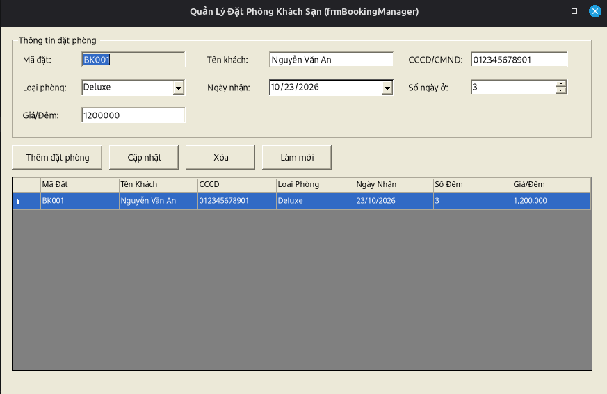
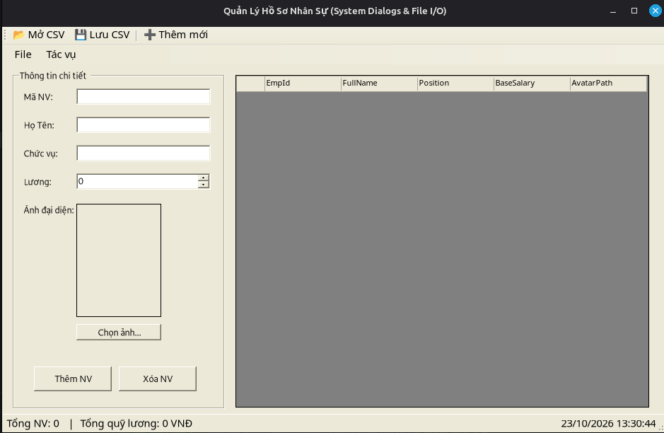
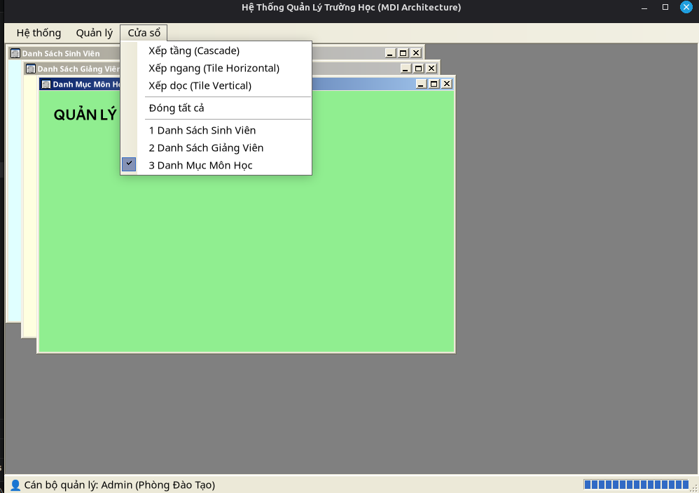
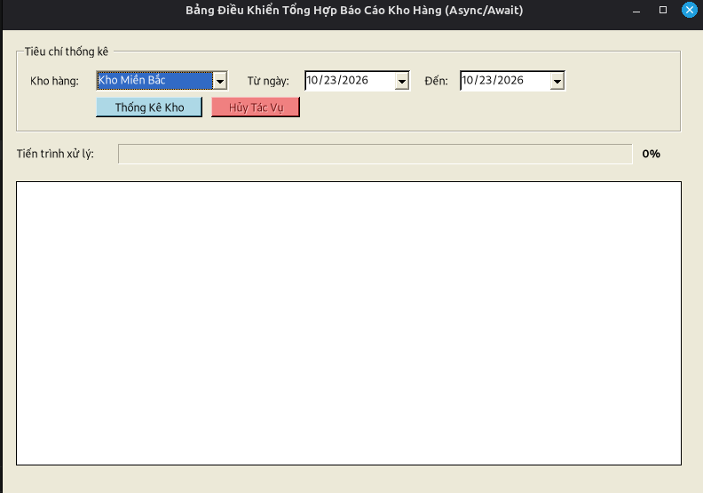
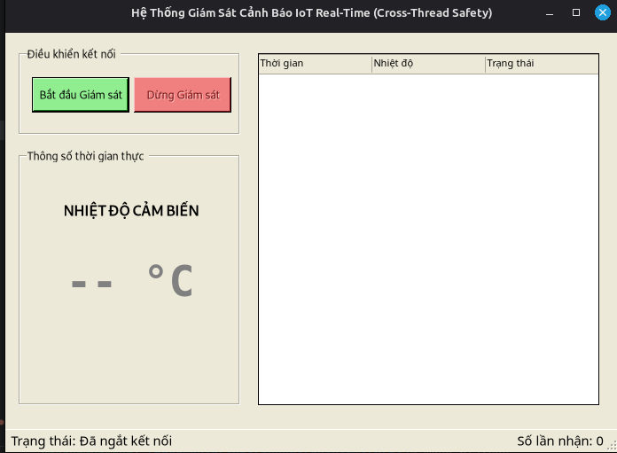

# BÁO CÁO BÀI TẬP THỰC HÀNH LẬP TRÌNH C# WINFORMS

## I. THÔNG TIN SINH VIÊN

* **Họ và tên:** Hoàng Gia Hưng

* **Mã số sinh viên:** 24810320102

* **Lớp học phần:** Lập trình .NET - Mã Lớp: D19QTANM1

* **Link Repository:** https://github.com/hoanggiahung/LTNET-TEST02_24810320102_HoangGiaHung

## II. DANH SÁCH BÀI TẬP HOÀN THÀNH & TỰ ĐÁNH GIÁ

| Bài tập | Tiêu đề bài tập | Trạng thái | Mức độ hoàn thành (%) | 
| ----- | ----- | ----- | ----- | 
| **Bài 1** | Quản lý Đặt phòng Khách sạn (Data Binding 2 chiều & Validation) | Hoàn thành | 100% | 
| **Bài 2** | Quản lý Hồ sơ Nhân sự & Lương (System Dialogs & File I/O) | Hoàn thành | 100% | 
| **Bài 3** | Hệ thống MDI Quản lý Trường học & Đào tạo (Kiến trúc MDI) | Hoàn thành | 100% | 
| **Bài 4** | Bảng Điều Khiển Tổng Hợp Báo Cáo Kho Hàng (Async/Await) | Hoàn thành | 100% | 
| **Bài 5** | Mô Phỏng Giám Sát Hệ Thống Cảnh Báo IoT Real-Time (Cross-Thread) | Hoàn thành | 100% | 

## III. MINH HỌA GIAO DIỆN & KỸ THUẬT NỔI BẬT

### 1. Bài 1: Quản lý Đặt phòng Khách sạn

* **Kỹ thuật áp dụng:** Khởi tạo cột DataGridView bằng code (`AutoGenerateColumns = false`), đồng bộ dữ liệu 2 chiều với `BindingList<T>` và `BindingSource`, kiểm tra hợp lệ dữ liệu nhập với `ErrorProvider`.

* **Hình ảnh minh họa Giao diện:**
<<<<<<< Updated upstream


>>>>>>> Stashed changes
*Mô tả: Giao diện quản lý đặt phòng, cho phép chọn dòng trên bảng để đẩy ngược dữ liệu lên các ô nhập liệu.*

### 2. Bài 2: Quản lý Hồ sơ Nhân sự & Lương

* **Kỹ thuật áp dụng:** Sử dụng `OpenFileDialog` để chọn ảnh chân dung nhân viên, `SaveFileDialog` và `OpenFileDialog` để đọc/ghi file định dạng CSV, tích hợp `StatusStrip` cập nhật tự động tổng số nhân viên và quỹ lương theo thời gian thực.

* **Hình ảnh minh họa Giao diện:**
<<<<<<< Updated upstream


>>>>>>> Stashed changes

*Mô tả: Giao diện quản lý nhân sự kèm hiển thị ảnh đại diện qua PictureBox và menu điều khiển tiêu chuẩn.*

### 3. Bài 3: Hệ thống MDI Quản lý Trường học & Đào tạo

* **Kỹ thuật áp dụng:** Xây dựng khung nhìn MDI Container (`IsMdiContainer = true`), quản lý vòng đời form con với thuật toán chống mở trùng lặp (`OpenOrActivate`), sắp xếp cửa sổ tự động (Cascade, Tile).

* **Hình ảnh minh họa Giao diện:**
<<<<<<< Updated upstream


>>>>>>> Stashed changes

*Mô tả: Khung ứng dụng chính điều hướng các phân hệ quản lý sinh viên, giảng viên và môn học dạng cửa sổ con.*

### 4. Bài 4: Bảng Điều Khiển Tổng Hợp Báo Cáo Kho Hàng

* **Kỹ thuật áp dụng:** Lập trình bất đồng bộ với từ khóa `async` và `await`, bọc tác vụ nặng vào `Task.Run` để giải phóng luồng chính, kết hợp `CancellationTokenSource` để hủy tác vụ và `IProgress<T>` cập nhật thanh tiến trình mượt mà không khóa UI.

* **Hình ảnh minh họa Giao diện:**
<<<<<<< Updated upstream


>>>>>>> Stashed changes

*Mô tả: Giao diện thống kê kho hàng chạy ngầm tải dữ liệu mà không gây ra hiện tượng Not Responding.*

### 5. Bài 5: Mô Phỏng Giám Sát Hệ Thống Cảnh Báo IoT Real-Time

* **Kỹ thuật áp dụng:** Thu thập dữ liệu định kỳ bằng Task Loop ngầm, tuân thủ nghiêm ngặt quy tắc Thread Safety trong WinForms bằng cơ chế kiểm tra `this.InvokeRequired` và gọi `this.Invoke()` để cập nhật an toàn lên giao diện.

* **Hình ảnh minh họa Giao diện:**
<<<<<<< Updated upstream


>>>>>>> Stashed changes

*Mô tả: Màn hình giám sát nhiệt độ cảm biến thời gian thực, tự động đổi màu cảnh báo đỏ/xanh và ghi nhật ký vào DataGridView.*
## IV. HƯỚNG DẪN CÀI ĐẶT & CHẠY DỰ ÁN
1. Clone Repository về máy:
```bash

git clone [https://github.com/hunghg2112/LTNET_24810320102_HoangGiaHung](https://github.com/hunghg2112/LTNET_24810320102_HoangGiaHung)
2. Mở file source, chọn file bài tập, mở file có đuôi .exe.
3. Bấm F5 hoặc chọn Start để biên dịch và chạy chương trình.
